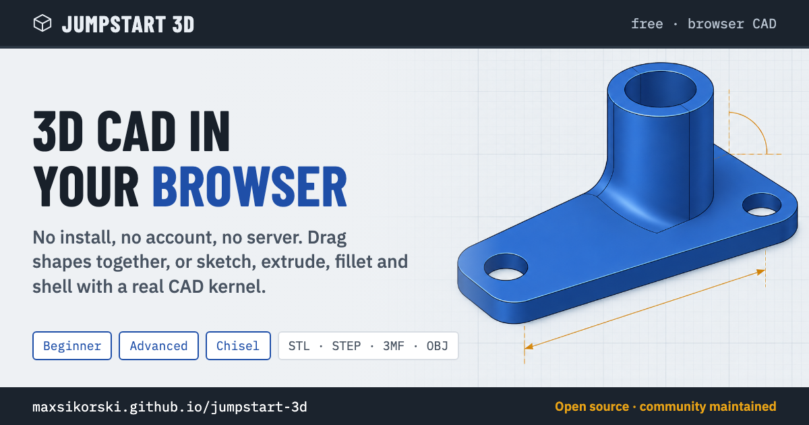

# JumpStart 3D

[](https://maxsikorski.github.io/jumpstart-3d/)

A free 3D CAD tool that runs in your web browser. No install, no account,
no server. Somewhere between Tinkercad and a real CAD program: drag shapes
together in Beginner mode, or sketch, extrude, fillet and shell in Advanced
mode.

Created by **J.Siwek**, who publishes it under the MIT License. Find him at
the [official site](https://classyapps.org/)
(his own downloads), his [source repository on GitHub](https://github.com/classyapps2026/jumpstart3d)
and his [video introducing 2.0](https://youtu.be/OmoVmYzoIsk).

This repository is the community fork, maintained by **Max Sikorski** with the
jumpstart-3d community: it put the app back online when the original
download disappeared, tracks his releases, and adds its own work (a
reproducible build, a test suite, named parameters, Mesh detail, OBJ export
and more, listed [below](#what-this-repository-adds-on-top-of-the-original)).
See [NOTICE.md](NOTICE.md) for credit and licensing.

## I just want to use it

Pick one:

- **Online:** open https://maxsikorski.github.io/jumpstart-3d/
- **Offline:** download
  [jumpstart-3d.html](https://github.com/MaxSikorski/jumpstart-3d/releases/latest/download/jumpstart-3d.html)
  and double-click it. That one file is the whole app. It works without an
  internet connection; the fonts are inside the file too.
- **macOS app:** the Electron wrapper shared by a community member in
  [issue #11](https://github.com/MaxSikorski/jumpstart-3d/issues/11) also
  works. In a folder containing `jumpstart-3d.html`, a `main.js` that loads it,
  and a `package.json` with `"main": "main.js"`, run:

  ```
  npm install --save-dev electron @electron/packager
  npx electron-packager . JumpStart --platform=darwin --arch=arm64
  ```

That is all. You do not need anything else in this repository.

**Fast after the first visit.** The website shows the workspace right away; the geometry engine (7 MB) downloads in the background, a small note in the corner of the 3D view shows how far it is, and shapes you add appear when it is ready. After that first visit the site keeps a copy on your computer, so it opens at once and works without an internet connection (only the fonts come from the web). When a new version is published it downloads in the background and a message asks you to reload. The downloaded single file is not affected.

**Back up your designs.** Designs live in this browser only (in its IndexedDB storage, which has room for big designs; browsers that block it fall back to the older, smaller storage). In Your designs, **Back up all designs…** saves them all into one file, and **Restore from backup…** puts them back, on this or another computer; it adds what is missing and never deletes anything. Clearing your browser's site data erases designs, so back up now and then. (Autosave checkpoints are not in the file.)

**Keep copies in a folder (Chrome and Edge on a computer).** In Your designs, **Save copies into a folder…** lets you pick a folder. From then on every design is also saved there as a project file, a few seconds after you stop editing and at once when you press Save, and those copies survive clearing the browser's site data. After the browser restarts it asks again: open Your designs and click **Allow**. Deleting a design leaves its file in the folder; to bring designs back, use Restore from a folder… below. Other browsers don't show this option.

**Restore from a folder.** In Your designs, **Restore from a folder…** adds back every design from the project files in a folder you pick, such as the copies folder above, in any browser on a computer; like Restore from backup it never deletes or overwrites anything. Your browser may ask whether to "upload" the files: nothing leaves your computer. Backup files and subfolders are skipped; use Restore from backup for a backup file.

**Keep designs on your own server (WebDAV).** If you run Nextcloud, a NAS or a web server with WebDAV, the **Your server** tab in Your designs keeps designs in a folder there, so every computer and browser you use can open them. Type the folder's address, your user name and password (on Nextcloud, an app password from Settings › Security) and click **Connect**; tick **Remember the password in this browser** to skip it next time. **Save the open design to the server** puts the design you have open there as a project file, the same kind Save copies into a folder writes. **Open** brings a server design into this browser: if you have not changed your copy since you last saved or opened it, the server's newer copy replaces it; if both changed, the server's opens as "… (from server)" and yours stays. Saving never overwrites a server copy that changed elsewhere without asking. Deleting a design in This browser leaves its server file. Your server must allow this page to talk to it: see Setting up your server below.

### Setting up your server

The Your server tab speaks WebDAV (not S3 or Windows shares, see the end of this section).

The usual home setup does not work by itself: the website you open is on https (GitHub Pages), and a NAS at home usually speaks plain http, which browsers refuse to mix with an https page ("mixed content"). There are two fixes: give the NAS a certificate and use its https:// address, or put the page on the NAS itself, next to the folder (see TrueNAS below), so the page and the folder share one address and nothing needs permission.

A browser only lets a web page talk to another address when that address agrees, so the server has to answer the page's "may I?" question (a request called OPTIONS) and add a few headers to every answer, errors included:

- `Access-Control-Allow-Origin`: `*`, or the address the page is opened from.
- `Access-Control-Allow-Methods`: `GET, PUT, DELETE, PROPFIND, MKCOL, OPTIONS`.
- `Access-Control-Allow-Headers`: `Authorization, Depth, Content-Type, If-Match`.
- The OPTIONS question has to be answered with a success (204 is usual) without asking for a password, because the browser sends it before it sends the password.

If Chrome asks whether the page may reach devices on your local network, allow it. If the folder is missing the tab says so and offers a **Create the folder** button (it never creates one by itself, so a typo in the address makes nothing). **Test connection** checks the address, user name and password without saving anything. The recipes below are not yet tried by us: tell us in an issue if one works, or what it needed.

**nginx** (needs the third-party `nginx-dav-ext-module`; the stock module cannot list a folder or answer OPTIONS):

```nginx
location /dav/ {
    root /srv;
    dav_methods PUT DELETE MKCOL;
    dav_ext_methods PROPFIND OPTIONS;
    client_max_body_size 64m;
    add_header Access-Control-Allow-Origin "*" always;
    add_header Access-Control-Allow-Methods "GET, PUT, DELETE, PROPFIND, MKCOL, OPTIONS" always;
    add_header Access-Control-Allow-Headers "Authorization, Depth, Content-Type, If-Match" always;
    if ($request_method = OPTIONS) { return 204; }
    auth_basic "JumpStart 3D";
    auth_basic_user_file /etc/nginx/dav.htpasswd;
}
```

**Apache** (`mod_dav`, `mod_dav_fs` and `mod_headers` switched on):

```apache
<Location "/dav/">
    Dav On
    Header always set Access-Control-Allow-Origin "*"
    Header always set Access-Control-Allow-Methods "GET, PUT, DELETE, PROPFIND, MKCOL, OPTIONS"
    Header always set Access-Control-Allow-Headers "Authorization, Depth, Content-Type, If-Match"
    AuthType Basic
    AuthName "JumpStart 3D"
    AuthUserFile /etc/apache2/dav.passwd
    <LimitExcept OPTIONS>
        Require valid-user
    </LimitExcept>
</Location>
```

**TrueNAS** (not yet tried by us). TrueNAS CORE 13 has a built-in WebDAV service (Services › WebDAV: HTTP on port 8080, or HTTPS on 8081 with a certificate) and WebDAV shares (Sharing › WebDAV Shares; each share points at a folder on a dataset). The address of a share is `http(s)://<your NAS>:<port>/<share name>/`, and the share name is case-sensitive. The service has one password, for the user `webdav`. Set its authentication to **Basic**: this page sends the password as a Basic login, so Digest will not work. TrueNAS SCALE removed the built-in service in 23.10 (Cobia); install the WebDAV app from its catalog (or Nextcloud) instead, and use the address the app shows. Neither lets you add the headers above, so use the no-headers route: put the page inside the share. Copy the single file `jumpstart-3d.html` (or the contents of `docs/`) into the WebDAV share, open it in the browser at the share's address (the browser asks for the webdav password once), and in Your server type the share's address, or just `./designs/` for a folder next to the page, then the user `webdav` and its password. The page opened from the share over plain http works because the page and the folder share one address, so no headers and no https are needed. A `storage.json` next to the page with `{ "webdav": "designs/" }` fills the address in for everyone who opens it, an iPad included.

**Nextcloud.** The address is `https://<your host>/remote.php/dav/files/<your user>/<folder>/`. Use an app password (Settings › Security), which also works when two-factor login is on. Nextcloud sends none of the headers above for WebDAV by itself, so put a reverse proxy in front that adds them and answers OPTIONS before Nextcloud sees it (the nginx lines above show the idea; the proxy also needs a body-size limit like `client_max_body_size 64m;`, because nginx's 1 MB default refuses bigger designs). Nextcloud slows down repeated failed logins, so check the password before clicking Connect again and again. A Synology or other NAS is the same story: it needs a proxy you control in front of it.

#### Self-hosting the page with a storage.json

If you put the website on your own server (copy the contents of `docs/`), you can spare your users typing the address: put a file `storage.json` next to `index.html` containing `{ "webdav": "https://your.server/dav/jumpstart/" }` (or a short address such as `"designs/"`, taken from where the page is). The page reads it the first time Your server is opened and only fills in the address field. Passwords never go in it. An address someone has already typed and connected with wins over the file. `docs/` is rebuilt from scratch every time, so the file lives on your server only, not in this repository.

The single file (`jumpstart-3d.html`) opened from your disk cannot read `storage.json`, so type the address. A page opened from disk has no web address of its own, so the server has to allow every origin (`*`). The saved password sits in the browser's storage for local files, which other local pages might be able to read: use an app password you can revoke.

#### Why not S3 or Windows shares

An S3 bucket needs a secret key that a web page would have to hold in the open, and browsers cannot speak the Windows file-sharing protocol (SMB) at all. WebDAV works with a user name and a password and runs on most NAS boxes and cloud drives.

## What it does

- Beginner mode: drag shapes, group them, cut holes, on a 256 × 256 mm
  build plate
- Advanced mode: sketches, extrude, revolve, loft, sweep, fillet, chamfer,
  shell, patterns (including along a path, and of whole features such as
  holes and cuts) and a feature timeline, driven by a real CAD kernel
  (OpenCascade)
- When a combine or Beginner Hole and Group leaves separate solid pieces,
  each piece becomes a separately movable body. Copies keep their own feature
  histories, so you can edit each piece independently.
- 3D Sketch: draw tubes and pipes freely in space
- Lathe: turn a body or a blank into a round part
- Jump Brick Builder (Advanced, Simulate): build with bricks
- Chisel: clay-style sculpting, with Puppet Animator
- Architechies (the author's fourth mode, new in 2.2): floor plans, walls,
  doors, windows and roofs for houses and buildings, sent to Beginner or
  Advanced as editable shapes at a scale you pick
- CAM Studio (the author's, new in 2.3; Advanced, Simulate): plan and
  simulate CNC router, mill or laser cuts and save G-code (GRBL, LinuxCNC,
  Mach3, Marlin); sending it to a machine over USB asks the browser's own
  permission first
- FlexiGen: print-in-place articulated figures
- Mesh to STEP: turn STL or 3MF meshes into editable STEP solids
- Forty-four step-by-step tutorials with built-in animations (the community build adds ten more; see below)
- Projector window, Media (pictures and video on objects), Picture to 3D
- Works on Mac, iPad and iPhone as well as Windows, Linux and Chromebooks
- Layer-by-layer print preview, section analysis, multi-filament colors
- Export to STL, OBJ, 3MF, STEP and DXF
- Named parameters: a Parameters list in the Advanced sidebar and in the
  Beginner shape panel, and sketch dimensions, feature values (extrude
  distance, revolve angle, fillet and chamfer size, hole diameter and depth,
  shell thickness), a Pattern's count, spacing and angle, and Beginner shape
  sizes (Width, Depth, Height) that take a name or an expression (`w`, `w/2`)
  and follow it when the value changes
- Pattern as an editable feature: in Advanced, a pattern of features (holes,
  cuts, bosses, text) or a "join copies" pattern of a shape is one Pattern
  entry in the timeline, not a pile of copies; double-click it to change the
  count, spacing or angle, and editing the source hole updates every copy.
  Patterns of separate bodies, Beginner patterns and path patterns still make
  plain copies
- **Bolts, nuts and threaded rods.** Fastener (in Beginner, and in Advanced under Create) makes a hex bolt, a hex nut, a threaded rod or a tap cutter in metric (M2.5 to M12) or inch (#6 to 1/2) sizes, with a print offset so printed parts screw together. The thread is a real thread you can edit later. A tap cutter is a threaded hole shape: put it in a solid and Group them.
- **Hole patterns.** Hole pattern (Advanced › Create › Advanced Create) drills rows, staggered rows or a circle of round holes into a flat face you click: plain, counterbore, countersink or tapped, with standard screw sizes, an edge margin and an angle. Holes that would not fit are left out. The result is one Hole feature you can edit later. Square, hex (sized across flats) and slot holes use the same layouts and are cut as one sketch and one Extrude cut, through the part or to a depth; stagger rows with a row pitch of 0.866 × the column pitch for a honeycomb.
- **Gears.** Gear (in Beginner, and in Advanced under Create › Advanced Create) makes a spur gear, a straight bevel gear or a rack from a module and a tooth count: involute teeth at 20°, a print clearance so printed gears turn freely, and an optional bore (with a DIN 6885 keyway on spur gears). It is an ordinary sketch and Extrude (a Loft for a bevel gear), so you can change a spur gear's width later; to change the teeth, undo and make it again. Bevel teeth are the usual CAD approximation (the tooth shape scaled toward the cone's tip). Helical gears are not built yet.
- **Name plates and tags.** Name plate (in Beginner, and in Advanced under Create › Advanced Create) makes a flat plate sized to one line of text: rounded or pill-shaped, with a hanging hole or two screw holes if you like, and the letters raised in a second colour or cut in. Raised letters are their own body, so a 3MF export keeps both colours, and on a printer with one nozzle you change filament at the top of the plate. Three bold fonts with English and Western European letters.
- **Printer plate and overhang shading.** Printer plate… (Settings menu, the half-moon button) sets the size of the plate you design on: Generic 256 × 256 (the old default), No printer boundary, or one of Bambu Lab A1, X1 / X1 Carbon, P1P / P1S, Original Prusa MK4 / MK4S, MINI+, Creality Ender-3 (original model) and Snapmaker U1. Beginner's blue mat takes the printer's width and depth (the MK4 is 250 × 210, a rectangle); Advanced keeps its grid and adds a thin outline. The dialog shows the printer's X × Y × Z, where the size came from and a plain line saying which parts reach outside it. It never moves, turns or changes a part. **Overhang shading** paints in red the faces that lean out more than a limit you choose (10 to 80°, 45° to start) from straight up, the printer building along Z. It marks steep undersides; it does not prove support is needed (bridges, support from another part, layer settings and cooling are the slicer's). The choice is a viewing preference kept on this device, not part of the design, an undo step or a share link. **Bed sizes are the makers' stated build volumes, checked on 2026-10-23 against the pages listed in `src/printerpresets.js`; none has been tried on a real printer, and the other printers in the 3D Print Sim list (kept as before) have sizes nobody has checked yet.** The 3D Print Sim opens on the printer you chose, a change inside it is the same choice, and it now measures the limit the same way (from upright, with the sine of the angle; it used the cosine, which agrees only at 45°, so a 30° or 60° limit now flags different faces).
- **Move and rotate sketches.** Move/Copy (Advanced › Transform, or the Move/Copy button when a sketch is selected in the Browser) also takes a sketch, picked in the viewport or from the sketch list in the dialog (hidden ones too). Type or drag a move and a turn to tilt or shift it; extrudes, revolves, sweeps and lofts made from it follow, and the sketch stays editable. "Create a copy" makes a second sketch and leaves the first where it was.
- **Turning a shape (issue #100).** Advanced has a Move / Rotate button at the start of Modify: one click on it (with a shape selected) shows the arrows and the three X, Y, Z rings, with the exact boxes beside them. Beginner has "Turn by" X, Y and Z boxes in the inspector: type any angle (decimals too) to turn the shape by that much around the middle of its box, as one undo step. Dragging an arc or ring turns in 15° steps; hold Shift, or choose Free in the new Snap 15° / Free switch (for a finger), to turn by any angle. A finger picks the arc drawn nearest to it, and a second finger drops the turn in progress. The turn buttons and the switch are 44 px targets (`src/rotationui.js`).
- Proof it is parametric: a fully-constrained mark on every sketch, dimension
  names `d1`, `d2`… you can use in any dimension, feature value or shape
  size, parameters importable and exportable as CSV, and a Parameters tutorial
- Mesh detail setting (Normal, Fine, Extra fine, or a custom level up to 32×
  with a live triangle count) for smoother curves in the view and in mesh
  exports

## Chat inside the app

Click the **AI** button in the top bar, pick a model, and type what you want ("a 40 by 30 by 20 block with an 8 mm hole
through it"). The model edits the design you have open through the same 38 tools the MCP server below has: it adds shapes,
cuts holes, moves and sizes them, looks at the view and offers an export. You can see every step it takes in the chat, and
undo it like any other edit.

| Provider | Address filled in for you | Key |
|---|---|---|
| Ollama | `http://localhost:11434` | not needed |
| LM Studio | `http://localhost:1234/v1` | not needed |
| OpenAI-style (OpenAI, OpenRouter, Groq, oMLX…) | `https://api.openai.com/v1` (change it for the others) | yes |
| Anthropic | `https://api.anthropic.com/v1` | yes |

Use **List models** to fill the model box from the server. Tick **Model can see images** if your model can (it then gets
screenshots of the view). For a local model pick one that supports tools, 9B or larger works best.

A local server has to allow the page to talk to it, once:

- **Ollama:** run it with `OLLAMA_ORIGINS="*"` and restart it. On macOS: `launchctl setenv OLLAMA_ORIGINS "*"`, then quit
  and reopen the Ollama app. On Linux: `systemctl edit ollama.service` and add `Environment="OLLAMA_ORIGINS=*"` under
  `[Service]`. On Windows: add the user environment variable `OLLAMA_ORIGINS` with the value `*`. The single file (opened
  from disk) needs the same setting.
- **LM Studio:** Developer › Server Settings › turn on **Enable CORS** (or start it with `lms server start --cors`), then
  start the server.

If Chrome asks whether the site may reach devices on your local network, allow it. Safari may block the website from reaching
`localhost`; use the single file there.

Your key stays in this browser and is saved only if you tick **Remember key in this browser**. Nothing is sent until you
press Send, and the model can only use the tools. **Allow scripts** is off unless you tick it: with it on, the model can run
any JavaScript in the page (the same trust as Open/Export › Run script…). The MCP route below stays for agents that run
outside the browser, such as Claude Code.

## Use it with an AI agent

Give any AI agent that can read a web page and run commands this one line, and it sets the server up for itself (it asks you
before it edits files outside the repository):

```
Read https://raw.githubusercontent.com/MaxSikorski/jumpstart-3d/main/mcp/AGENT-SETUP.md and set it up for me.
```

(If the agent cannot fetch the address, use the same file on the web page:
[mcp/AGENT-SETUP.md](https://github.com/MaxSikorski/jumpstart-3d/blob/main/mcp/AGENT-SETUP.md).)

If you use Claude Code, two commands let your agent build and edit designs in JumpStart 3D, look at the result and export
STL, STEP, OBJ or 3MF files:

```
claude plugin marketplace add MaxSikorski/jumpstart-3d
claude plugin install jumpstart-3d@maxsikorski
```

To have the agent edit the design you have open, turn on **Connect to AI agent** in the theme menu (the half-moon button); it is
off unless you turn it on. Without that, the agent works in its own invisible browser (run `npx playwright@1.62.1 install chromium` once).
The command line (`jumpstart run`, `export`, `shot`, `status`), the full tool list and the safety notes are in
[mcp/README.md](mcp/README.md).

### Other agents

Any client that starts a stdio MCP server can use it; `mcp/README.md` has the exact file and block for each.

| Client | How to add | Does a screenshot reach the model? |
|---|---|---|
| Claude Code | the plugin above | yes |
| Codex (CLI, desktop app) | `~/.codex/config.toml`, or `codex mcp add` and then `tool_timeout_sec = 600` under that server in the same file | not confirmed |
| Hermes Agent | `~/.hermes/config.yaml` | yes (text-only model: file path) |
| OpenCode | `opencode.json` | not documented |
| Gemini CLI, Antigravity | `~/.gemini/settings.json`, `~/.gemini/config/mcp_config.json` | Gemini CLI yes |
| Cursor | `~/.cursor/mcp.json` | yes |
| Cline, LM Studio | `cline_mcp_settings.json`, `~/.lmstudio/mcp.json` | not reliably; use the `path` option |
| Grok Build | `~/.grok/config.toml` | not documented |
| Open WebUI | through the `mcpo` bridge | not documented |
| ChatGPT on the web | cannot: remote servers only (the Codex desktop app works, see its row) | |

Ollama and oMLX run models only; put one of the agents above on top. When a model cannot see images, the agent can call
`screenshot` with a `path` and the picture is saved to that file instead. The shape most clients read:

```json
{ "mcpServers": { "jumpstart-3d": { "command": "node", "args": ["<repo>/mcp/server.mjs"] } } }
```

## See it in action

The author's own tour of version 2.0:
[JumpStart 3D Design is BACK! Version 2.0](https://youtu.be/OmoVmYzoIsk)
(12½ minutes: the three modes, Lathe, 3D Sketch, patterns, the print
simulator, Chisel's animator and the projector). Mike at Making Layers walks
through Beginner, Advanced and Chisel in
[4 New 3D CAD/Modeling Programs!](https://youtu.be/KGi11k9tQhA?t=308)
(from 5:08). More videos, posts and things people made are collected in
[COMMUNITY.md](COMMUNITY.md); add yours there.

## Where to find us

- The official JumpStart 3D site, with the author's own downloads:
  https://classyapps.org/
- The author's source repository: https://github.com/classyapps2026/jumpstart3d
- Reddit: https://www.reddit.com/r/Jumpstart3D/ for questions, prints and ideas
- GitHub Discussions, for announcements, polls and Q&A:
  https://github.com/MaxSikorski/jumpstart-3d/discussions

## Support the project

JumpStart 3D is free and stays free. If it saves you time, you can chip in
towards the maintainer's hosting and coffee. Both are Stripe payment links;
no account needed.
The About dialog also has a Support button.

- One-time, any amount: https://buy.stripe.com/28E4gydyeetR0S9aNb0gw08
- Monthly: https://buy.stripe.com/7sYcN479Q71p44l1cB0gw09

This supports the community build only; the original author is credited in
the app's About dialog and in NOTICE.md.

## Help improve it

You do not need to write code to help.

- **Found a bug?** Open an issue:
  https://github.com/MaxSikorski/jumpstart-3d/issues/new/choose and pick
  "Bug report". Say which browser you use and what you clicked, and attach a
  saved project file if you can.
- **Want a feature?** Same page, pick "Feature request". Describe the
  problem you are trying to solve; that helps more than a specific design.
- **Have a question, or want to show what you made?** Use
  [Discussions](https://github.com/MaxSikorski/jumpstart-3d/discussions):
  Q&A for "how do I", Show and tell for pictures of your prints.
- **Know the answer to someone else's issue or question?** Reply to it.
  Helping other users counts.
- **Want to change the code?** Read on, and see
  [CONTRIBUTING.md](CONTRIBUTING.md) for the full guide.
- **Want to support the work with money?** See
  [Support the project](#support-the-project) above.

## I want to change it or contribute

Follow [REVIEW.md](REVIEW.md) for the outcome check, review checklist, and five
review gates. Contributors write the outcome and test for gate 1; the
maintainer runs gates 2-3 with AI reviewers (a Codex model and a Claude model);
CI runs gate 4; the maintainer checks gate 5.

The app is plain JavaScript modules under `src/`, from the author's own
source release of version 2.3 (the untouched 2.0 files are on the
`upstream-originals` release). One command bundles them into the website
and the single offline file.

You need [Node.js](https://nodejs.org/) (version 18 or newer). Then:

```
git clone https://github.com/MaxSikorski/jumpstart-3d.git
cd jumpstart-3d
npm install
node build.mjs
```

`npm install` fetches one tool, esbuild, pinned to the version the author
used. The build writes two things:

- `docs/` the website (the same files GitHub Pages serves; not committed on `main`)
- `dist/jumpstart-3d.html` the single offline file

To try the website locally, serve the `docs/` folder with any static
server, for example:

```
npx serve docs
```

### Running the tests

The tests drive the real app in a headless browser: both builds, Beginner and
Advanced, the kernel, the helpers and the exports. Once, after `npm install`,
fetch the browser with `npx playwright@1.62.1 install chromium`. Then, after a build:

```
npm test
```

`test/README.md` explains what runs and how to re-record the golden export
hashes after an intended geometry change.

Every night, CI also slices the golden STL and 3MF files with PrusaSlicer and checks their STEP files in FreeCAD, rejecting mesh repairs, invalid or open geometry, missing solids and volume changes; `test/judge-known.json` lists the few known defects and must only shrink; see `test/README.md`.

`npm test` also walks a first part on a simulated phone (box, hole, group, STL) over a slow connection and fails if it takes longer than its budget.
Chat geometry benchmark: `npm run test:chat-judge` checks five scripted cases on both builds (the mock tests the scorer, not how well a model understands a request), while `npm run bench:chat` scores 50 requests on demand against a locally installed Ollama `qwen3:14b` with scripts and vision off, writing local reports to `chat-bench-results/`; see [setup, CORS and commands](test/README.md#chat-geometry-benchmark).

`node tools/measure-load.mjs` times a page load on a simulated 10 Mbit connection; `test/README.md` explains the numbers.

### Where things are

```
src/index.html      page shell, CSS and menus
src/app.js          the app's entry point; the other src/*.js files are its modules
                    (beginner.js, advanced.js, sketcher.js, kernel.js, projects.js, ...)
src/worker.js       geometry worker that runs the CAD kernel (kernel.js) via replicad
src/occt-gz.wasm    OpenCascade kernel, gzipped
src/flexigen.html, src/meshstep.html, src/chisel.html
                    the helper pages, built; their source is in tools/
src/meshdetail.js   our Mesh detail setting
src/printerpresets.js where each bed size came from (added to the rows of printsim.js's printer list) and the saved Printer plate choice
src/printerpreview.js our Printer plate dialog and the red overhang shading in the design view
src/overhang.js     the one overhang rule, shared by the design view and the 3D Print Sim
src/params.js       our named parameters (evaluator and the dimension and feature hooks)
src/bridge.js       our scripting bridge, `window.JS3D` (see BRIDGE.md)
src/runscript.js    our "Run script…" menu entry (runs a .js file with JS3D in scope)
src/report.js       our "Report a problem" dialog (a prefilled GitHub bug report link)
src/sharelink.js    our Share link: a small design in a web address, and opening one (see below)
src/loadui.js       our loading note over the 3D view, and the start of the offline copy on the website
src/sw.js           our service worker: the website's offline copy (the site build only)
src/remote.js       our Your server tab in Your designs (designs on a WebDAV server)
mcp/                our MCP server for AI agents, its Claude Code plugin and skill, the `jumpstart`
                    command line and AGENT-SETUP.md, the page an agent reads to set itself up
                    (see mcp/README.md); it has its own package.json, so `npm ci` inside
                    mcp/ once; its tests run with `npm run test:mcp`
skills/             a copy of the agent skill (mcp/skills/jumpstart-3d/SKILL.md) where `npx skills add`
                    and other agents' skill folders look; a test keeps the two identical
.claude-plugin/     marketplace.json, so `claude plugin marketplace add` finds the plugin in mcp/
third_party/        the libraries the build bundles: three.js, replicad, opentype.js,
                    Flatbush, Flatqueue, the OpenCascade loader
LICENSES/, THIRD-PARTY-NOTICES.md
                    licenses of everything in third_party/ and of the fonts
build.mjs           the build (the author's dist.sh and standalone.py, in Node)
tools/              helper page sources and the scripts that rebuild them
                    (see tools/README-helpers.md); og-card/ renders the link-preview image;
                    bridge-demo.js is a script for Open/Export › Run script… (or the console);
                    measure-load.mjs times a page load on a simulated slow connection
BRIDGE.md           the `JS3D` calls and the project file format
docs/               built website: not on `main` (gitignored); `/ship` builds it onto the `release` branch,
                    which GitHub Pages serves
jumpstart_3d_v2.0.htm      historical upstream v2.0 build (src/ now uses 2.3)
UPSTREAM-README.md         the author's README from the source release
```

### Rules of thumb

- After any change run `node build.mjs`, then `npm test`, then try both
  outputs yourself: the site in a browser and `dist/jumpstart-3d.html` opened
  from disk. The local site keeps its service worker, so after a rebuild reload
  twice: the first reload shows the old build and the "new version" message.
- Do not commit `docs/` or `dist/`. Pull requests carry source only: the
  maintainer's release step builds `docs/` onto the `release` branch (the
  site) and attaches the single file to the release.
- Keep "Created by J.Siwek" in the About dialog. Our additions are listed
  below, not claimed as the original.

## What this repository adds on top of the original

- OBJ export in the Open/Export menu
- glTF export (`.glb`) in the Open/Export menu: one mesh and one base colour per body, in metres with Y up, for web viewers, Blender and game engines (`src/gltf.js`)
- OBJ import in Beginner and Advanced: reads vertex positions and faces into one body, then uses the same mesh repair and units path as other imported meshes; materials are ignored (`src/objimport.js`)
- No waiting at a splash screen: the workspace opens while the geometry engine loads, and the website works offline after one visit through a service worker (`src/loadui.js`, `src/sw.js`, the site build only)
- Installable as an app: Install in Chrome/Edge, Add to Dock in Safari
- Back up all designs and Restore from backup in Your designs: every design in this browser in one JSON file, and an additive restore that never deletes or overwrites (`src/projects.js`)
- Designs are stored in the browser's IndexedDB instead of the 5 MB localStorage, so a design with an imported mesh no longer fills the browser up; designs saved the old way are copied over on the first visit and their old copies are left in place, so an older version of the app still finds them as they were that day; browsers where IndexedDB fails keep the old way (`src/projstore.js`)
- Save copies into a folder in Your designs (Chrome and Edge): every design kept up to date as a project file in a folder you pick, so clearing the browser's site data no longer loses work (`src/folder.js`)
- Restore from a folder in Your designs: adds back the designs from the project files in a folder you pick, in any browser on a computer, through the same never-overwrite rules as Restore from backup (`src/projects.js`)
- A Your server tab in Your designs: list, open, save and delete designs in a folder on your own WebDAV server (Nextcloud, a NAS, Apache or nginx) as the same project files the folder copies use, never overwriting a copy changed elsewhere without asking (`src/remote.js`)
- Link previews: when the site address is shared on Discord, Reddit, iMessage,
  Slack or X, it shows a title, a description and a 1200×630 card image. The
  tags live in `src/index.html`; the card is rendered from `tools/og-card/`
- Fasteners: a Fastener dialog (Beginner toolbar, Advanced › Create › Advanced Create) and `JS3D.fastener` / the `add_fastener` tool make a hex bolt, hex nut, threaded rod or tap cutter as ordinary bodies built from the app's own Thread feature. Thread sizes come from the Thread dialog's table; head and nut sizes follow ISO 4017 and 4032 (metric) and ASME B18.2.1, B18.2.2 and B18.6.3 (inch) (`src/fasteners.js`)
- Hole patterns: a Hole pattern dialog (Advanced › Create › Advanced Create) and `JS3D.holePattern` / the `add_hole_pattern` tool lay out a grid, a staggered grid or a circle of round holes on a flat face and write them as one ordinary Hole feature (every position in one `hole` mod, so it edits in the Hole dialog and undoes in one step); square, hex and slot holes are written as one sketch with an outline per hole and one Extrude cut instead. The face's own edges set the grid's directions, and holes that would not fit inside the face and its margin are left out (`src/holepattern.js`)
- Gears: a Gear dialog (Beginner toolbar, Advanced › Create › Advanced Create) and `JS3D.gear` / the `add_gear` tool make a spur gear, a straight bevel gear or a rack from a module and a tooth count, as ordinary hidden sketches of straight lines plus the app's own Extrude (two sketches and a straight Loft for a bevel gear, its bore a Hole feature). The teeth follow the ISO 53 basic rack at 20° (addendum 1 module, dedendum 1.25), eight points a flank, with a print clearance taken off every tooth; fewer than 17 teeth are drawn plain (not undercut) with a warning. Nothing in the kernel changed (`src/gears.js`)
- Name plates: a Name plate dialog (Beginner toolbar, Advanced › Create › Advanced Create) and `JS3D.namePlate` / the `add_name_plate` tool make a plate sized to one line of text (rounded or pill, with a hanging hole or two screw holes), as one hidden sketch plus the app's own Extrude, with the letters either a second body in its own colour (a Text shape) or cut in (the Deboss text feature). The text is measured on the main thread from the same outlines the drawing code uses, and characters the fonts lack are refused. Nothing in the kernel changed (`src/nameplate.js`)
- Printer plate and overhang shading: `src/printerpresets.js` adds `dimensionEvidence` to each row of the printer list (`PRINTERS` stays in `printsim.js` as the author wrote it and registers itself there) (`vendor-verified` with the date and the maker's pages for the seven named choices, `unverified` for the rest) and the saved choice (`jumpstart.printerplate.v1`). `viewport.js` takes the plate size (`setPlateSize`, the grid shader's `halfSize` is now a `vec2`) and draws Advanced's outline. `printerpreview.js` makes the dialog and a display-only overlay on each body view: it shares the mesh's position buffer, owns only a triangle list and a red material, classifies in short slices (`overhang.js`, about 8 ms each) and throws away stale work, stands aside for the print sim, Section analysis, joint simulations and the Projector, and waits for a button on meshes over 1,000,000 triangles. Measured on a Node run: 2.4 million triangles in about 0.2 s, longest slice about 9 ms. `printsim.js` uses the same rule instead of `cos(limit)`
- Sketch move and turn: Move/Copy also takes a sketch, picked in the viewport, in the Browser or from the dialog's list, and moves or turns it by changing its plane (`o`, `x`, `n`). The file format is unchanged, and features that use the sketch rebuild from the new plane. A copy is a new sketch; the features stay on the original (`// jumpstart-3d: sketch move` blocks in `moveCmd`, `src/advanced.js`)
- Rotation access: `src/rotationui.js` holds the drag-angle rule (15°, or the pointer's own angle with Shift or Free), the turn matrix, the Snap 15° / Free switch and the nearest-arc touch pick. Beginner's arc drag and Advanced's ring drag both use it; Advanced Modify starts with Move / Rotate (Move/Copy opened in Free in 3D); Beginner's inspector has typed "Turn by" fields. No stored-data, kernel or network change
- Underside view: seen from below the plate, the Beginner workplane and the Advanced dark-theme ground turn nearly clear (faint lines stay), so you can see the underside of your part (a few lines in `src/viewport.js`)
- Chat inside the app: an AI button opens a panel where a model (Ollama, LM Studio, OpenAI or Anthropic) edits the open
  design through the same 38 tools as the MCP server. Keys stay in the browser; scripts are off unless you tick them
- Boolean fixes in the geometry engine: a torus no longer disappears from a group, two spheres offset along x intersect and cut to the right volume, and an empty result says "Nothing is left" instead of showing a raw engine message (a marked block in `third_party/replicad/src/shapeFunctions/operations.ts` and `src/kernel.js`; `test/booleans.spec.mjs`)
- Joined torus groups export at the right size: their STL was about 3% short
- Mesh detail in the theme menu: Normal, Fine, Extra fine, or a custom level
  up to 32× set by a slider or by typing the triangle count you want. It
  controls how finely curved surfaces are divided into triangles, for the view
  and for STL, OBJ and 3MF exports, and asks before building more than
  500,000 triangles. The original always used the Normal level.
- The website build keeps the 7 MB kernel as a separate file, so the page
  itself is about 5 MB instead of 14 MB
- The About dialog's top row has **Check for updates**, **Visit the community
  build** (the main GitHub button), **Support** and **J.Siwek's site**; the
  update button checks our GitHub releases only when clicked
- A reproducible build from readable source, with the libraries pinned
- Imported SVG drawings are stripped of scripts, embedded HTML and event
  handlers before the app reads their geometry, so a booby-trapped file cannot
  run code in the page
- Proof it is parametric: every sketch shows a ✓ when fully constrained (or
  how many degrees of freedom are left, as a plain count, so an estimate),
  every dimension has a name (`d1`, `d2`…) that any dimension, feature value
  or shape size can use (`d1/2`), the Parameters list exports and imports as
  CSV (one undo step), and a Parameters tutorial walks through it
- Named parameters: a Parameters section at the top of the Advanced browser
  (add, rename, edit, delete, undo). Give a parameter a name and a value or
  expression (`40`, `w/2`, `1in`), then type the name or an expression in any
  sketch dimension or in a feature's value box (extrude distance, revolve
  angle, fillet and chamfer size, hole diameter and depth, shell thickness);
  the sketch, the feature and everything built on it follow when the
  parameter changes. A value tied to a name shows its expression and an `fx`
  look in the dialog, and the timeline reads `Extrude (dist = t)`. A
  Beginner shape's Width, Depth and Height boxes take them too, and the shape
  panel lists the parameters under its other settings; typing a plain number,
  or resizing on the canvas, frees that size again. Parameters are saved in
  the project file; older files open unchanged. A Pattern's count, spacing
  and angle take them too (`Pattern (n1 = n)` on the timeline). Parameters
  are lengths, so a count or angle parameter typed in inch mode is scaled by
  25.4: make those in mm mode
- Pattern as an editable feature (Advanced): a new `pattern` entry in a
  body's feature list repeats the earlier hole, cut, boss or text features it
  names (by id, so editing the source updates every copy), or the whole shape
  so far, fusing the copies into it (Fusion's "pattern bodies, joined").
  Rectangular (one or two directions, optionally both sides) and circular;
  the axes and centre are saved in the body's own coordinates, so the pattern
  follows the body when it is moved or turned. The Pattern dialog opens again
  from the timeline (Edit Pattern). Still baked, as before: Beginner patterns,
  patterns of several bodies left separate (they are separate bodies) and path
  patterns. A trailing uneven Scale turns the body into a mesh, as it does for
  any feature it cannot replay
- Scripting bridge: `window.JS3D` lets a script, the browser console or a
  tool server build and edit Beginner shapes (add, move, turn, resize, scale,
  group, holes, parameters), read each body's size and volume, undo, take a
  screenshot, export STL, OBJ, 3MF, STEP or the project file, and open a project
  file, with the same bytes the Export menu gives. It does nothing until it is
  called, and works in the single file too. `BRIDGE.md` lists every call and
  documents the project `.json` format; `tools/bridge-demo.js` is an example
  you can paste into the console
- Open/Export › Run script…: pick a `.js` file and it runs with `JS3D` in
  scope, no console needed; the result or the error shows as a message
- Open/Export › Report a problem… (and About): opens a new bug report on GitHub
  with the app details already filled in (build, website or file, browser, mode,
  and the last error message only if you tick the box, with names and paths taken out) and what you typed; never your design. You
  can save a copy of the design to attach. The app sends nothing: you press the
  link and then Create on GitHub
- Open/Export › Share link…: puts a small design into a web address (after the `#`)
  that you copy and send. Nothing is uploaded and no service stores it; the
  browser does not send that part to any server. Whoever opens the link is asked
  first and the design opens as a new design, never over theirs. The whole
  project goes in (hidden shapes, names, parameters, embedded models), it is not
  encrypted, and anyone with the link can open a copy. The link is capped at
  4096 characters; a bigger design is offered as a project file instead. In the
  downloaded file, Share link… makes a link to the community website, and
  Import shared link (in the same box) opens a pasted link without the website.
  Designs that use features a link cannot carry (Chisel, Architechies, joints,
  textures and a few others) are refused with "Use a project file for this design"
- An MCP server for AI agents (`mcp/`): Claude Code or any MCP client can build
  and edit designs through tools that mirror `JS3D`, either in the tab you have
  open (theme menu › Connect to AI agent, off unless you turn it on) or in a
  headless browser. `mcp/README.md` has the install lines, the tool list and
  what an agent can and cannot do
- A Claude Code plugin (two install commands) with a skill that teaches an agent
  to use those tools, a `jumpstart` command line that runs a script or makes
  an export or a picture without an agent, and a one-line prompt that has any
  other agent (Codex, Hermes, OpenCode, Gemini CLI, Cursor...) set the server
  up for itself; `screenshot` can save its picture to a file for models that
  cannot see images
- Ten more tutorials on top of the author's forty-four (five Beginner, five Advanced, 54 in all): they teach the 41 toolbar buttons that had no tutorial, such as copy and paste, mirror, lock, name plates, fasteners, gears and hole patterns. The lessons are in `src/tutorial_data_community.js`; the author's tutorial files are untouched
- A regression test suite (`npm test`) that drives the real app in a headless
  browser on both builds; a short part gates every pull request and the rest runs nightly

## License

MIT. The author released the source of version 2.0 under the MIT License
(on his first official site, https://sites.google.com/view/jumpstart-3d-creator/home,
and in his GitHub repository, https://github.com/classyapps2026/jumpstart3d).
This repository's additions, by Max Sikorski and the community, use the same
license. The author's repository has the app source but not the bundled
libraries; this repository has both, so it builds on its own. The full text is in
[LICENSE](LICENSE); credit, history and third-party licenses are in
[NOTICE.md](NOTICE.md).
