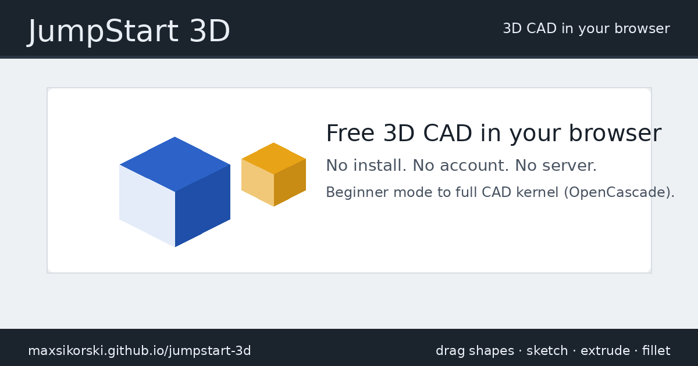

# JumpStart 3D

[](https://maxsikorski.github.io/jumpstart-3d/)

A free 3D CAD tool that runs in your web browser. No install, no account,
no server. Somewhere between Tinkercad and a real CAD program: drag shapes
together in Beginner mode, or sketch, extrude, fillet and shell in Advanced
mode.

Created by **J.Siwek**. This is a community-maintained copy; see
[NOTICE.md](NOTICE.md) for credit and licensing.

## I just want to use it

Pick one:

- **Online:** open https://maxsikorski.github.io/jumpstart-3d/
- **Offline:** download
  [jumpstart-3d.html](https://github.com/MaxSikorski/jumpstart-3d/releases/latest/download/jumpstart-3d.html)
  and double-click it. That one file is the whole app. It works without an
  internet connection (only the fonts come from the web).

That is all. You do not need anything else in this repository.

## What it does

- Beginner mode: drag shapes, group them, cut holes
- Advanced mode: sketches, extrude, revolve, loft, sweep, fillet, chamfer,
  shell, patterns and a feature timeline, driven by a real CAD kernel
  (OpenCascade)
- Chisel: clay-style sculpting, with Puppet Animator
- FlexiGen: print-in-place articulated figures
- Mesh to STEP: turn STL or 3MF meshes into editable STEP solids
- Sixteen step-by-step tutorials with built-in animations
- Projector window, Media (pictures and video on objects), Picture to 3D
- Works on Mac, iPad and iPhone as well as Windows, Linux and Chromebooks
- Layer-by-layer print preview, section analysis, multi-filament colors
- Export to STL, OBJ, 3MF, STEP and DXF
- Mesh detail setting (Normal, Fine, Extra fine, or a custom level up to 32×
  with a live triangle count) for smoother curves in the view and in mesh
  exports

## See it in action

Mike at Making Layers walks through Beginner, Advanced and Chisel in
[4 New 3D CAD/Modeling Programs!](https://youtu.be/KGi11k9tQhA?t=308)
(from 5:08). More videos, posts and things people made are collected in
[COMMUNITY.md](COMMUNITY.md); add yours there.

## Help improve it

You do not need to write code to help.

- **Found a bug?** Open an issue:
  https://github.com/MaxSikorski/jumpstart-3d/issues/new/choose and pick
  "Bug report". Say which browser you use and what you clicked, and attach a
  saved project file if you can.
- **Want a feature?** Same page, pick "Feature request". Describe the
  problem you are trying to solve; that helps more than a specific design.
- **Have a question, or want to show what you made?** Use
  [Discussions](https://github.com/MaxSikorski/jumpstart-3d/discussions):
  Q&A for "how do I", Show and tell for pictures of your prints.
- **Know the answer to someone else's issue or question?** Reply to it.
  Helping other users counts.
- **Want to change the code?** Read on, and see
  [CONTRIBUTING.md](CONTRIBUTING.md) for the full guide.

## I want to change it or contribute

The app is plain JavaScript modules under `src/`, from the author's own
source release of version 1.94. One command bundles them into the website
and the single offline file.

You need [Node.js](https://nodejs.org/) (version 18 or newer). Then:

```
git clone https://github.com/MaxSikorski/jumpstart-3d.git
cd jumpstart-3d
npm install
node build.mjs
```

`npm install` fetches one tool, esbuild, pinned to the version the author
used. The build writes two things:

- `docs/` the website (the same files GitHub Pages serves)
- `dist/jumpstart-3d.html` the single offline file

To try the website locally, serve the `docs/` folder with any static
server, for example:

```
npx serve docs
```

### Running the tests

The tests drive the real app in a headless browser: both builds, Beginner and
Advanced, the kernel, the helpers and the exports. Once, after `npm install`,
fetch the browser with `npx playwright install chromium`. Then, after a build:

```
npm test
```

`test/README.md` explains what runs and how to re-record the golden export
hashes after an intended geometry change.

### Where things are

```
src/index.html      page shell, CSS and menus
src/app.js          the app's entry point; the other src/*.js files are its modules
                    (beginner.js, advanced.js, sketcher.js, kernel.js, projects.js, ...)
src/worker.js       geometry worker that runs the CAD kernel (kernel.js) via replicad
src/occt-gz.wasm    OpenCascade kernel, gzipped
src/flexigen.html, src/meshstep.html, src/chisel.html
                    the helper pages, built; their source is in tools/
src/meshdetail.js   our Mesh detail setting
third_party/        the libraries the build bundles: three.js, replicad, opentype.js,
                    Flatbush, Flatqueue, the OpenCascade loader
LICENSES/, THIRD-PARTY-NOTICES.md
                    licenses of everything in third_party/ and of the fonts
build.mjs           the build (the author's dist.sh and standalone.py, in Node)
tools/              helper page sources and the scripts that rebuild them
                    (see tools/README-helpers.md); og-card/ renders the link-preview image
docs/               built website, committed so GitHub Pages can serve it
jumpstart_3d_v1.94.htm     the untouched upstream file this version came from
UPSTREAM-README.md         the author's README from the source release
```

### Rules of thumb

- After any change run `node build.mjs`, then `npm test`, then try both
  outputs yourself: the site in a browser and `dist/jumpstart-3d.html` opened
  from disk.
- Commit the rebuilt `docs/` with your change. `dist/` is not committed; the
  single file is attached to releases instead.
- Keep "Created by J.Siwek" in the About dialog. Our additions are listed
  below, not claimed as the original.

## What this repository adds on top of the original

- OBJ export in the Open/Export menu
- Link previews: when the site address is shared on Discord, Reddit, iMessage,
  Slack or X, it shows a title, a description and a 1200×630 card image. The
  tags live in `src/index.html`; the card is rendered from `tools/og-card/`
- Mesh detail in the theme menu: Normal, Fine, Extra fine, or a custom level
  up to 32× set by a slider or by typing the triangle count you want. It
  controls how finely curved surfaces are divided into triangles, for the view
  and for STL, OBJ and 3MF exports, and asks before building more than
  500,000 triangles. The original always used the Normal level.
- The website build keeps the 7 MB kernel as a separate file, so the page
  itself is about 5 MB instead of 14 MB
- A reproducible build from readable source, with the libraries pinned
